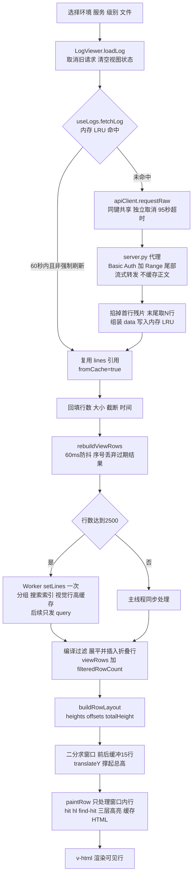

# 数据链路：从加载到展示

> 讲什么：一次日志加载经过哪些环节、每一层缓存什么、什么时候失效。系统分层见 [SYSTEM](SYSTEM.md)，功能见 [FEATURES](FEATURES.md)。

**一句话**：日志正文不落盘。远端尾包 → 浏览器内存（60 秒 LRU）→ Worker 分组 → 虚拟列表只渲染窗口内行。

## 全链路

## 逐段说明

**1. 触发与竞态**：`loadLog()` 由首次进入、切换环境/服务/级别/文件、刷新按钮、设置改加载上限触发。它以 `loadSeq` 判定最新请求、用 `AbortController` 取消旧请求，先确保级别索引就绪，再 `resetViewData()` 清空 `lines`、`viewRows`、滚动位置与高亮缓存。

**2. 取数**：`useLogs.fetchLog(host, app, level, filename, { force, envKey, signal })`。

- 缓存键：`envKey|host|app|level|file|maxLines|tailMB`；`envKey` 必填，避免同名服务跨环境取错地址。
- 非 `force` 时命中内存 LRU 直接返回同一份 `lines` 引用，不发请求。
- 未命中时 `trackInflight` 让同键并发只发一次请求，`attachInflight` 让每个调用方独立脱离（全部脱离才中止底层请求）；超时 95 秒。
- 请求 `GET /api/proxy?url=&tail=`，`tailBytes` 来自设置的 `tailMB`（默认 10MB）。

**3. 后端代理**：`server.py` 加 Basic Auth 与 `Range: bytes=-N`；上游支持 Range 时按 64KB 分块流式转发，并回传 `X-Total-Size`、`X-Truncated`；不支持时整段读入后裁尾。目录探测超时 8 秒、带尾包 30/90 秒、整文件下载 300 秒。**后端不缓存日志正文**，只有带 hash 的 `/assets/` 强缓存 7 天。

**4. 解析与写入内存**：读 `res.text()`；`X-Truncated=true` 时丢掉第一行残片；`takeLastLines()` 从末尾取最多 `maxLines` 行（默认 10000，大文本避免全量切分）。组装 `{ lines, size, downloadedBytes, truncated, lineCapped, filename, maxLines, tailMB, fromCache }` 后写入 LRU，然后 `releaseResponse()` 释放定时器与信号监听。响应头里的 `ETag` / `Last-Modified` 只记入缓存 meta，**当前未用于条件请求**（代理也未转发上游这两个头）。

**5. 生成视图行**：`rebuildViewRows()` 把 `lines` 与过滤词、折叠集合、换行、列宽交给 `processLogAsync()`。

- 少于 2500 行或 Worker 不可用 → 主线程同步处理。
- ≥2500 行 → `setLines` 仅在 `lines` 引用变化时发送一次，Worker 常驻分组条目、小写搜索索引与按 `(wordWrap, wrapCols)` 缓存的视觉行数；之后只发 `query`（条件 + 折叠/换行参数），连续查询合并、过期结果丢弃。
- 两端返回同构的 `{ viewRows, filteredRowCount }`；过滤按 include AND / exclude OR 编译；折叠条只插入占位行并标记 `clipped`，正文不截断。
- 过滤词、折叠、换行、字体变化走 60ms 防抖，`processSeq` 丢弃过期结果。

**6. 布局与渲染**：`buildRowLayout()` 由每行 `visualLines × 基准行高` 生成 `heights` / `offsets` / `totalHeight`；二分求可见窗口，前后各缓冲 15 行，用 `translateY(offsets[startIdx])` 定位，外层撑起总高。`renderedRows` 只遍历窗口内行：`paintRow()` 先经 `highlightLine()` 做转义、级别着色与过滤词 `hit`，再由 `applyTextHighlights()` 追加 `hl` 与 `find-hit`，HTML 按「行键 + 词表」缓存（超过 800 条清空）；模板用 `v-html` 输出，命中样式必须写在 `global.css`。查找跳转直接用 `offsets[rowIndex]` 计算 `scrollTop`；上下文弹窗按原始 `row.idx` 从 `lines` 取窗口，与过滤结果解耦。

## 缓存分层

| 内容 | 位置 | 生命周期 |
| --- | --- | --- |
| 日志正文 `lines` | 内存 `logBodyCache`，LRU 12 条、TTL 60 秒 | 刷新页面即丢失，不跨标签 |
| 分组条目 / 搜索索引 / 视觉行数 | Worker 内存，`setLines` 时重建 | 换 `lines` 引用或 Worker 重建时失效 |
| `viewRows`、高亮 HTML `hlCache` | 主线程内存 | 条件变化或 `resetViewData()` 时重建 |
| 文件名与级别索引 | localStorage `log_viewer_file_index_v1` | 持久，按日软刷新，跨标签同步 |
| 过滤历史、设置、导航折叠、抽屉固定态 | localStorage | 持久 |
| 构建产物 `/assets/*` | 浏览器 HTTP 缓存 | 7 天 |

完整的本地存储键见 [SYSTEM.md](SYSTEM.md)。

## 失效与回源

- **直接用缓存**：60 秒内切回同一环境/服务/级别/文件且参数未变。
- **强制回源**（`force: true`）：刷新按钮、切换历史文件、日期筛选、设置改 `maxLines` / `tailMB`；同时跳过 LRU 查表。
- **清空视图但保留缓存**：`resetViewData()` 在每次加载前执行；切服务不会删 LRU，因此 60 秒内切回来仍可能命中。
- **刷新页面**：内存缓存全部丢失，localStorage 的索引、历史、设置与抽屉固定态仍在。

## 已知边界

- 上下文弹窗只读内存里已加载的尾部数据，更早的行**不会联网补拉**。
- 代理未转发 `ETag` / `Last-Modified`，条件请求尚未启用。
- 整文件下载是独立端点，不走上述正文缓存；断点续传 / Range 分片仍为预留设计。
- 日志正文无轮询，只在打开、切换、刷新时拉取；统计页与在线心跳有自己的定时器。

## 相关文档

[系统架构](SYSTEM.md) · [功能清单](FEATURES.md) · [设计规范](DESIGN.md) · [变更记录](CHANGELOG.md)
