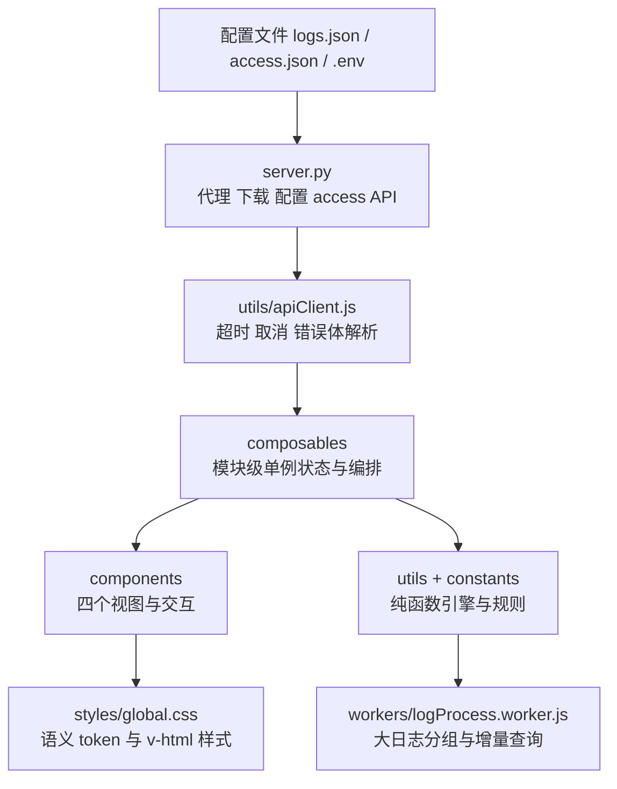

# 系统架构

> 讲什么：系统的分层、目录、视图与前后端边界。运行命令见 [README](../README.md)，日志如何加载与缓存见 [DATA-FLOW](DATA-FLOW.md)，编码约束见 [DESIGN](DESIGN.md)。

## 技术栈

| 层次 | 技术 |
| --- | --- |
| 前端 | Vue 3 + Vite + Element Plus（按需引入） |
| 后端 | `server.py`，单进程托管构建产物、代理、下载与访问统计 API |
| 配置 | `config/logs.json`、`config/access.json`、根目录 `.env` |
| 数据 | 日志来自远端 LogIndex 服务；访问统计存 SQLite `data/access.db` |
| 运维 | `manage.py` / `manage.bat` |

前端只与同源后端通信，不直连 LogIndex。绝大多数界面改动无需改后端。

## 分层



各层职责与禁止事项见 [DESIGN.md](DESIGN.md)。要点：

- `composables` 是共享状态的唯一来源，模块级单例，组件之间不靠父子 ref 传递导航状态。
- `utils` 与 `constants` 不依赖 Vue；`workers` 常驻大日志数据，只接收命令。
- `components` 只做渲染与本地交互；网络请求经 `apiClient` 收口。

## 视图与导航

| 视图 | 组件 | 说明 |
| --- | --- | --- |
| 仪表盘 `dashboard` | `Dashboard.vue` | 环境切换、模块列表、探测级别、下载 |
| 日志聚合 `viewer` | `LogViewer.vue` | 日志阅读与搜索工具区 |
| 统计 `stats` | `AccessStats.vue` | 在线与访问事件（白名单可见） |
| 设置 `settings` | `SettingsPage.vue` | 外观 / 字体 / 行为 / 配置四分区，偏好草稿保存后生效 |

- `App.vue` 用 `keep-alive` + `defineAsyncComponent` 分发，二级导航**仅在 `viewer` 挂载**。
- 一级导航四项：仪表盘 / 日志聚合 / 统计 / 设置；两级侧栏可分别折叠（本地持久化）。
- 地址栏 `?view=&env=&app=&host=&level=&file=` 双向同步，刷新与分享可还原，见 `useNavigation.js`。

## 目录

```text
frontend/src/
├── App.vue / main.js
├── components/
│   ├── nav/          # NavPrimary / NavSecondary / NavViewSwitch / NavEnvModuleTree
│   ├── viewer/       # LogViewer、LogFilterBar、LogFoldBar、LogContextDialog
│   │                 # LogToolsDrawer、LogHighlightBar、LogFindBar、LogHistoryBar
│   ├── dashboard/    # Dashboard
│   ├── stats/        # AccessStats
│   └── settings/     # SettingsPage + Appearance / Typography / Behavior / ConfigTransfer
├── composables/      # useLogs / useNavigation / useSettings / useLogViewFilters
│                     # useLogSearchTools / useConfigTransfer / usePresence / useAccessLog / useToast
│                     # useVersionCheck
├── constants/        # logLevels / logFileRules / logHighlightRules / logContextConfig
│                     # themes / timing / settingsOptions / logSearchTools / version
│                     # storageKeys（所有本地存储键的唯一来源）/ versionCheck
├── utils/            # apiClient / logParser / logEntries / logViewRows / logProcessClient
│                     # logFilterMatch / logFind / logVirtualLayout / logFileIndex
│                     # highlightTerms / toolDrawerState / filterHistory / logDownload
│                     # logContextWindow / logTextMetrics / dirListing / color
│                     # downloadName / configBundle / versionCheck
├── workers/          # logProcess.worker.js
└── styles/           # global.css（静态 token、UI 原子类、v-html 样式）
```

单测与性能基准在 `frontend/tests/`（无第三方测试依赖）。配置导入前的备份写在 `backup/`（已 gitignore）。

## 后端边界

| 端点 | 用途 |
| --- | --- |
| `GET /config/logs.json` | 环境与服务配置；`access.json` 明确拒绝对外提供 |
| `GET /api/proxy?url=&tail=` | 加 Basic Auth 与 `Range: bytes=-N`，流式回传日志尾部与 `X-Total-Size` / `X-Truncated` |
| `GET /api/download?url=&file=` | 不带 tail，整文件流式下载，带附件头与总大小 |
| `POST /api/access/hello\|ping\|event` | 在线心跳与操作埋点 |
| `GET /api/access/me\|online\|recent\|summary` | 统计查询，后三者仅白名单 IP |
| `GET /api/config/export` | 返回 `logs.json` / `access.json`，仅白名单 IP |
| `POST /api/config/import` | 写回服务端配置，仅白名单 IP；1MB 上限、结构校验、备份后原子写 |

`/api/download` 的路由必须排在 SPA fallback 之前；只有 `/assets/` 下带 hash 的构建产物设置了 7 天强缓存，**代理响应不缓存日志正文**。

版本更新检查**不经过后端**：前端直连 `api.github.com` 的公开 tags 接口（端点在 `constants/versionCheck.js`），只读、不携带任何内网信息，失败或限流时静默降级；结果按 1 小时缓存在 localStorage。

## 本地持久化

| 键 | 存储 | 用途 |
| --- | --- | --- |
| `log_viewer_settings` | localStorage | 主题、字体、阅读行为 |
| `log_viewer_settings_init` / `log_viewer_wordwrap_on_v1` | localStorage | 首次初始化、旧设置迁移标志 |
| `log_viewer_nav_l1_collapsed` / `log_viewer_nav_l2_collapsed` | localStorage | 两级导航折叠 |
| `log_viewer_file_index_v1` | localStorage | 文件名、级别索引与目录页大小，按日软刷新、跨标签失效 |
| `log_viewer_filter_history` | localStorage | 过滤条件历史（最多 15 条） |
| `log_viewer_tools_drawer_v1` | localStorage | 搜索工具抽屉是否固定 |
| `log_viewer_access_sid` | sessionStorage | 在线会话标识 |
| `log_viewer_version_check` | localStorage | GitHub 最新 tag 与检查时间，1 小时缓存 |

日志正文不在表中：它只在内存里短期缓存，详见 [DATA-FLOW.md](DATA-FLOW.md)。

## 相关文档

[功能清单](FEATURES.md) · [数据链路](DATA-FLOW.md) · [设计规范](DESIGN.md) · [访问统计](ACCESS.md) · [变更记录](CHANGELOG.md)
